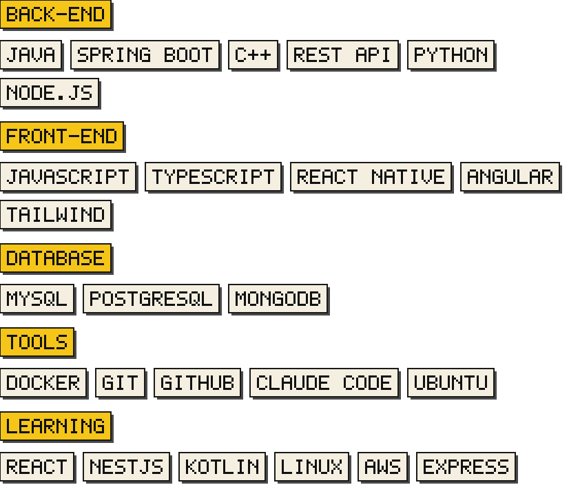

```
    o8o                          .o8            oooo
    `"'                         "888            `888
   oooo  .oooo.   oooo d8b  .oooo888   .ooooo.   888
   `888 `P  )88b  `888""8P d88' `888  d88' `88b  888
    888  .oP"888   888     888   888  888ooo888  888
    888 d8(  888   888     888   888  888    .o  888
    888 `Y888""8o d888b    `Y8bod88P" `Y8bod8P' o888o
    888
.o. 88P
`Y888P
```

```
.----------------------------------------------------------------------.
| (x) (-) (+)              ~/about.txt                                 |
|----------------------------------------------------------------------|
|                                                                      |
| Systems Analysis and Development student at Estácio,                 |
| from Ceará, Brazil. Graduated from Colégio Dom Felipe.               |
|                                                                      |
| Back-end with Java and Spring Boot. Currently learning               |
| React, NestJS, Kotlin and AWS.                                       |
|                                                                      |
| Portuguese (native), English (learning).                             |
| -@luizjardel                                                         |
|                                                                      |
'----------------------------------------------------------------------'
```

<p align="center">
  
  
</p>





<p>
  <a href="https://www.youtube.com/@devjardel13"></a>
  <a href="https://www.instagram.com/dev.jardel/"></a>
  <a href="https://www.linkedin.com/in/luiz-jardel/"></a>
</p>


<p>
  
  
</p>


